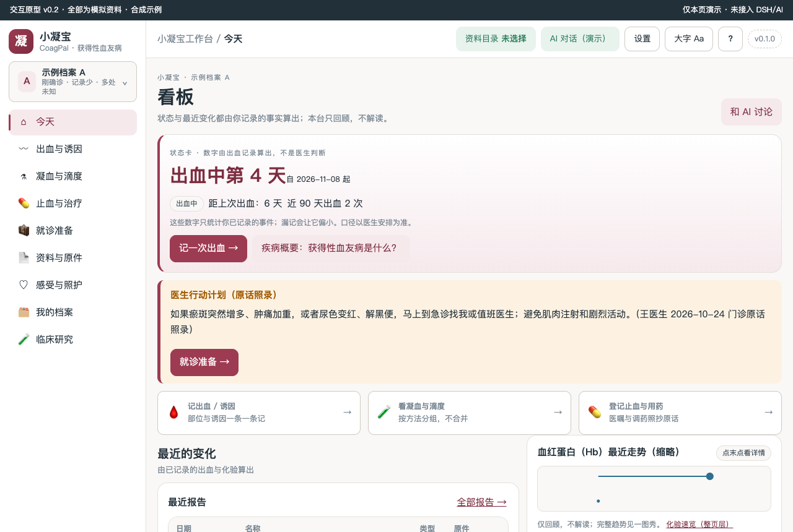
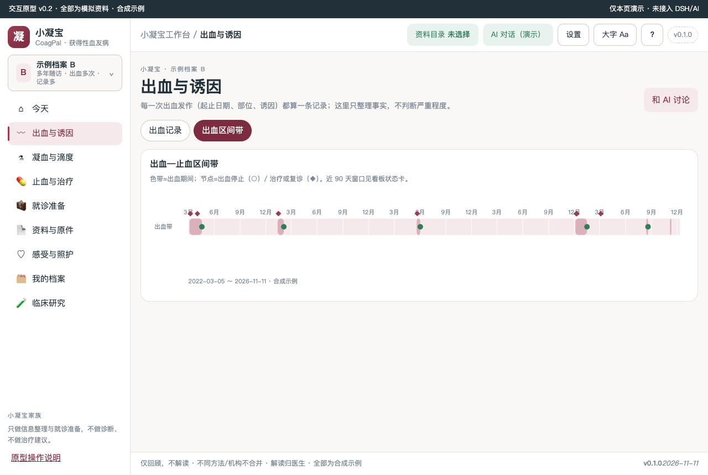
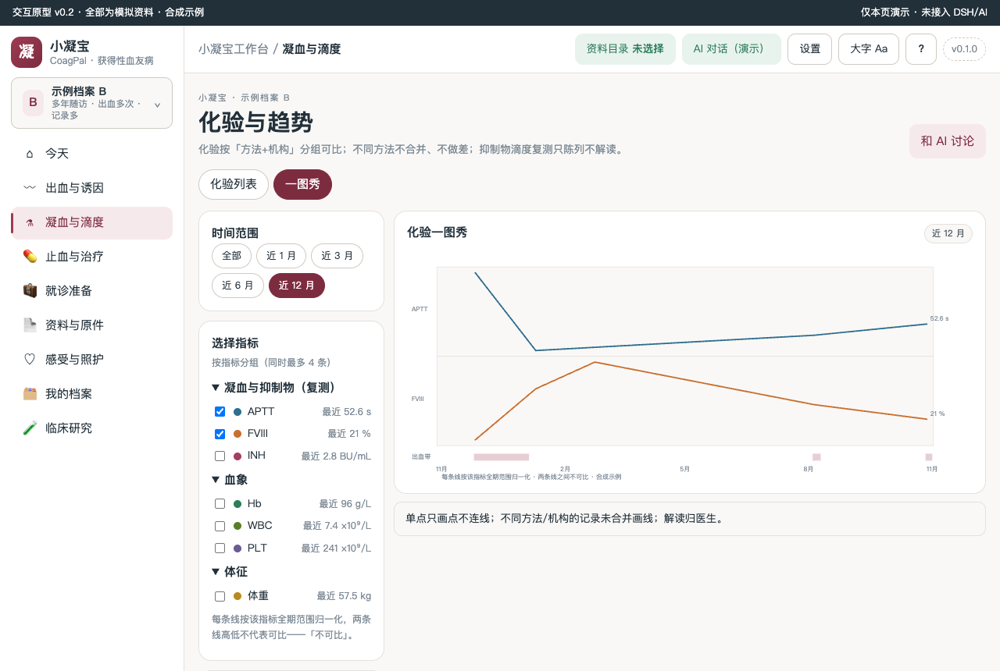
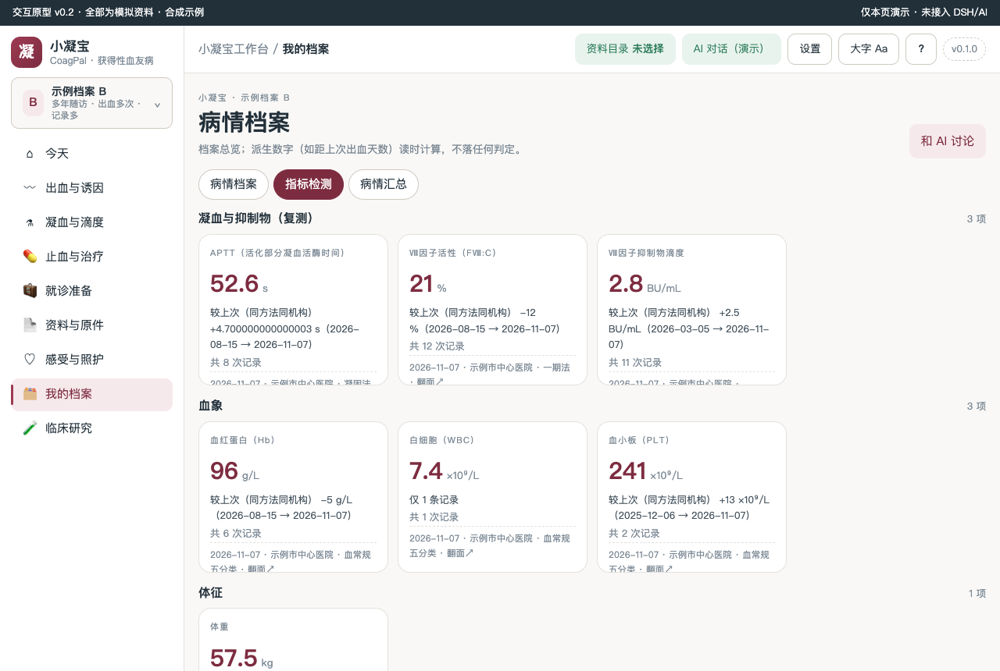
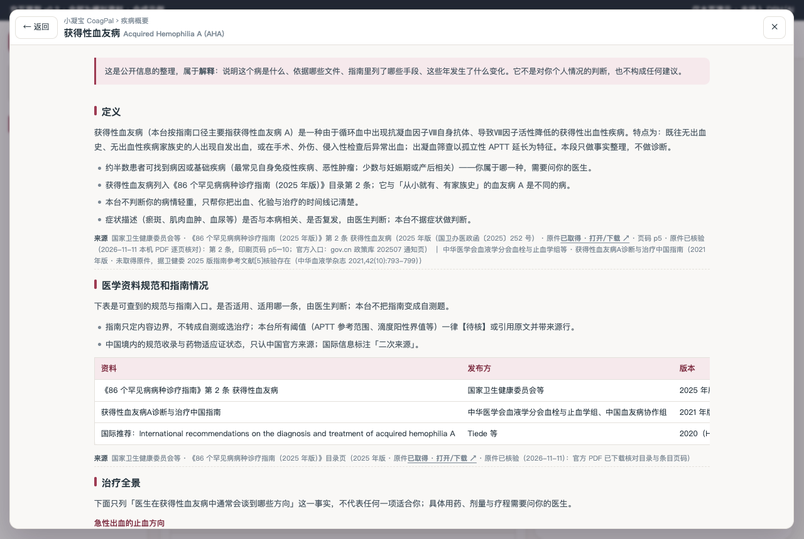

# 获得性血友病工作台

获得性血友病（AHA）患者与照护者的本机病程资料工作台：把出血发作、aPTT 与Ⅷ因子活性、抑制物滴度、血红蛋白、止血与免疫抑制治疗整理成可核对、可回溯的材料，并整理成就诊能带着走的问题清单。

原型与开发版结构对齐家族基准；需求见 [BRIEF](docs/BRIEF.md)，规格见 [SPEC](docs/SPEC.md)，证据台账见 [EVIDENCE-LEDGER](docs/EVIDENCE-LEDGER.md)。

## 疾病概要

**获得性血友病（Acquired Hemophilia A, AHA）**：由于体内出现抗凝血因子Ⅷ的自身抗体、Ⅷ因子活性降低导致的获得性出血性疾病。特点：既往无出血史、无家族史的人出现自发出血（大片瘀斑、肌肉血肿最常见），化验筛查表现为孤立性 APTT 延长。约半数可找到基础病因（自身免疫病、恶性肿瘤等）。它与「从小就有、有家族史」的血友病 A 是不同的病。

### 定义
循环血中出现抗 FⅧ 自身抗体 → Ⅷ因子活性降低 → 自发出血；筛查特征为孤立性 APTT 延长。
### 医学资料规范和指南情况
国家卫健委《86 个罕见病病种诊疗指南（2025 年版）》第 2 条（原件已核验）；中华医学会血液学分会《获得性血友病A诊断与治疗中国指南（2021 年版）》（原文未取得，据二次来源）；国际推荐 Haematologica 2020。
### 目前治疗全景概要
（按受累器官与病情轻重排列，不代表任何一项适合你，需要问你的医生）：急性出血的止血方向（旁路途径药物等）；抑制物清除（糖皮质激素 ± 利妥昔单抗/环磷酰胺）；基础疾病排查与支持监测。
### 发展趋势
只写已发生事实——2025 年指南收载；CARE 中国登记（2019）与 EACH2 欧洲登记（2012）发表；2024 年国内多中心随机对照研究发表（Am J Hematol）。本台不预测。

来源：《86 个罕见病病种诊疗指南（2025 年版）》第 2 条 p5–10（原件已核验）。工作台顶栏「?」可查看完整四段疾病概要，每段带来源行。

## 关键功能（截图墙）

> 截图为 prototypes/v0.2 交互原型实渲（合成示例数据）。



看板：今天页的状态卡（出血中第 N 天 / 距上次出血 / 近 90 天出血次数），数字由你记录的出血算出，不是医生判断。



出血与诱因：色带=出血期间，○=出血停止，◆=治疗或复诊；都来自你登记的记录。



凝血与滴度一图秀：每条线按该指标全期范围归一化；不同方法/机构不合并；单点只画点。


.png)

指标检测 3D 卡：正面最近值与来源，翻面看走势（背面不改栅格高度）；凝血与抑制物 / 血象 / 体征三组。



疾病概要（顶栏 ？ 或首页文字入口）：定义 → 医学资料规范和指南情况 → 治疗全景 → 发展趋势，每段带来源行。

## 怎么用

1. 装入 DSH Desktop（或在原型目录直接打开 `prototypes/v0.2/index.html` 查看交互原型）。
2. 首次进入是演示数据（A：刚确诊记录少；B：多年随访记录多），侧栏可切换；全部为合成示例。
3. 记录：出血、化验、治疗/调药、就诊问题，均可在对应页「＋」按钮录入（演示态不持久化）。
4. 复诊前：我的档案 → 病情汇总 → 「导出预览（私密过滤后）」，带着去门诊。
5. AI：每页「和 AI 讨论」只填草稿不自动发送；顶栏「AI 对话」在宿主内创建原生会话。

## 数据与口径

- 仅回顾，不解读；解读归医生。不同方法/机构不合并、不做差。
- 阈值一律【待核】或引用指南原文并带来源行；界面不写自动判定，无判读列。
- 私密记录三出口过滤：看板摘要 / 导出 / AI 上下文共用同一过滤函数。
- 0 患者访谈、0 临床审核（见 docs/USER-RESEARCH.md）；临床试验线如实裁剪（见 docs/CLINICAL-DATA.md）。

## 开发顺序

先共创SPEC和候选数据关系，再交付HTML交互工作台；由用户确认对应版本/模块后，复核SCHEMA/API并实现生产功能。确认记录见docs/PROTOTYPE-REVIEW.md；模型不依赖前端Tab/流程。模板骨架不是业务已确认。

## 当前能力

- 一个 DSH 工作台注册、认证的健康接口、版本展示与标准/大字切换。
- 已明确选择布局：business-first。business-first 使用 customFrame；模板不创建会话或复制聊天。需要 AI 协助时按官方合同接入原生 conversation 和会话管理。
- 无业务数据库、无演示患者、无真实密钥；所有业务页按确认 spec 逐项实现。

## 开发与本地验收

需要 Node.js 22+、Git、包管理器和可用 DSH Desktop；采用 SQLite 时另核验 node:sqlite 版本条件。宿主 peers 的范围仅是模板基线，请与目标 Desktop 实际依赖核对。

```bash
npm install
npm run check
npm run pack:check
npm pack
```

`npm run check` 只保证"能装"（语法 + 装包合同），第一天就该是绿的。`npm run audit` 管"还是不是家族里的一员"：版本三处一致、`lib/layout.js` 面板参数单一来源、检查链完整、文档与密钥卫生，**只看代码与文件，不看文档自述**。新项目刚生成时 audit 必然有 fail，那是待办清单；交付/发布前必须清零，存在 fail 不得发布（`npm run release:check` 一次跑完两者）。

跑的时间点：**每次改完**跑 `check`；**G2 原型确认后、写业务代码前**先跑一次 `audit`（这时缺的多是 `lib/layout.js`、`VERSION` 这类结构，越早补越便宜）；**交付/装机前**必须跑 `release:check`；**发布或投稿前**把 `npm run audit --json` 的 `xx/xx 通过 · N 失败 · M 待人工` 抄进 `docs/RELEASE.md` 的「家族一致性」一行。`✗` 是结构缺口（补齐，或在 `docs/DEV-REQUIREMENTS-<日期>.md` 写明偏离理由并由用户确认），`!` 是需人工判断的项（逐条给「已人工确认 / 确实没有」）。

`npm install` 可能按 npm 策略解析 peer；勿为消警告重复打包宿主 runtime。客户端本身是单文件；引入 TS/组件库后需添加构建步骤并保留单文件导出。

本地安装入口以当前 Desktop/CLI 帮助为准。安装后按 [docs/06-VALIDATION-AND-RELEASE.md](docs/06-VALIDATION-AND-RELEASE.md) 与官方自测完成真实 UI 验收，并填写 [docs/ACCEPTANCE.md](docs/ACCEPTANCE.md)。静态检查不代表已加载。

Logo 来源与使用限制见 assets/README.md。许可证、作者、仓库/发布策略由本项目维护者确认后填写；模板默认为 private/UNLICENSED。

感谢小x宝社区、DataElement 社区，以及 sam / hhx / 繁华的 ❤️ 贡献。

初始化来源记录见 `.dsh-wb-starter.json`。更新社区脚手架不会覆盖本项目；需要升级时先用相同确认配置在临时目录生成，再审阅差异。CLI 用法见 [docs/CLI-GIT.md](docs/CLI-GIT.md)。

## HTML先行与数据演进

业务开发前先交付HTML交互工作台原型、实际预览并由用户确认版本/hash和范围。数据设计先区分领域事实、流程状态和页面读模型，走查前端/流程变化、兼容与迁移；原型对象不直接作为表。见[规范](docs/14-HTML-AND-DATA-CONTRACT.md)。
